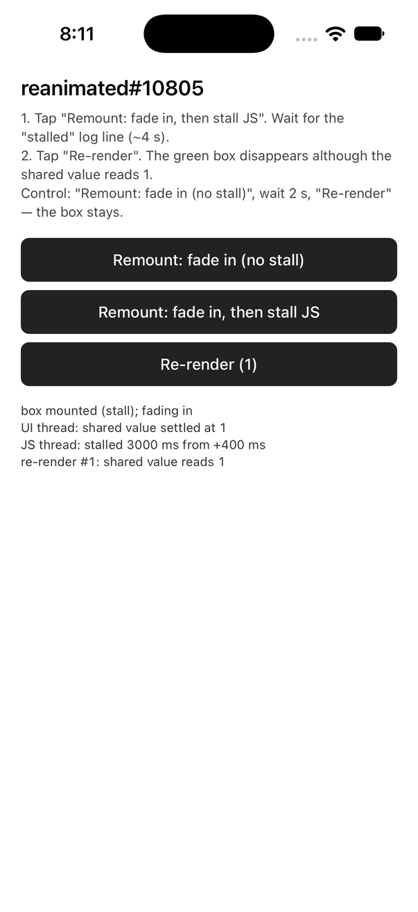

# reanimated#10805 — settled `useAnimatedStyle` value evicted before React sees it

Minimal reproduction for [software-mansion/react-native-reanimated#10805](https://github.com/software-mansion/react-native-reanimated/issues/10805).

With `FORCE_REACT_RENDER_FOR_SETTLED_ANIMATIONS` at its default (`true` since 4.3.0), a settled
animated value is handed to React only if the 500 ms garbage-collector tick runs while the value's
age is in `(1 s, 2 s]` (`getSettledUpdates` removes entries older than 2 s *before* collecting those
older than 1 s). If the JS thread is busy across that window, the next tick deletes the entry
unseen, and the next React render re-sends the component's **initial** animated style with nothing
to override it.

Everything is in [`App.tsx`](App.tsx). A green box fades in (`opacity` 0 → 1 over 150 ms) and sits
at the bottom of the screen.

## Run

```sh
npm install
npx expo run:ios      # iOS simulator; a device works too
```

Expo SDK 57 · react-native 0.86.3 · react-native-reanimated 4.5.1 · react-native-worklets 0.10.1 ·
New Architecture · Hermes · UIScene lifecycle (`expo-build-properties` › `enableSceneSupport`, which the
iOS 27 SDK in Xcode 27 requires to launch at all). No Reanimated feature flags changed, no babel config
beyond `babel-preset-expo`.

## Steps

1. Tap **Remount: fade in, then stall JS** — a fresh box mounts and fades in; 400 ms later the JS
   thread busy-waits for 3 s (so no GC tick can run while the settled value is 1–2 s old).
2. Wait for the log line `JS thread: stalled 3000 ms …`.
3. Tap **Re-render** (a `useState` bump in the parent).

**Actual:** the green box disappears. The log shows the shared value still reads `1`.

**Expected:** the box stays visible — nothing changed the animated value.

**Control:** **Remount: fade in (no stall)**, wait 2 s, **Re-render** — the box stays.



Verified on the iOS 27.0 simulator (iPhone 17), Debug build + dev bundle, Xcode 27.0: fails 2/2,
control passes. The original sighting was a Release build on an iPhone 16 Pro Max / iOS 27.0,
where a background launch (an App Intent under UIScene) delays JS timers by 5–11 s — the same
window, no synthetic stall needed.

### Why the box has to be remounted

`settledProps` is state on the `AnimatedComponent` instance
(`createAnimatedComponent/AnimatedComponent.tsx` › `_syncStylePropsBackToReact`) and is never
reverted, so once any settle of a prop has been handed back, every later render re-sends that value.
Only the **first** settle of a prop on a fresh component is exposed — which is why real apps meet
this on cold start (chrome fading in while the JS thread is busy), and why a scenario here starts
with a fresh box.

## Workaround

```json
"reanimated": { "staticFeatureFlags": { "FORCE_REACT_RENDER_FOR_SETTLED_ANIMATIONS": false } }
```

in `package.json`, then rebuild the native app. The registry then keeps the value and the commit
hook re-applies it on every React commit (the pre-4.3 behaviour).
